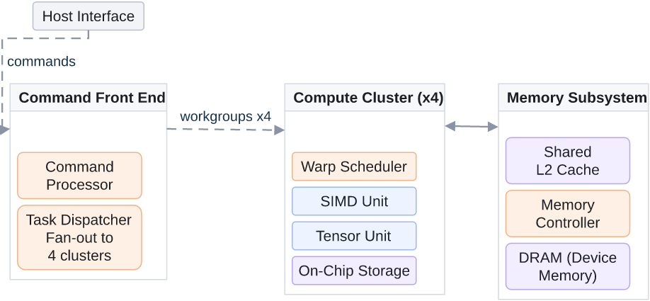
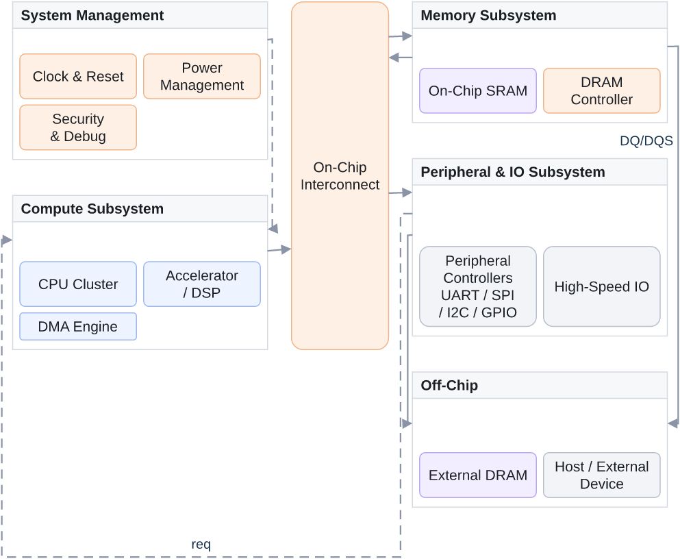
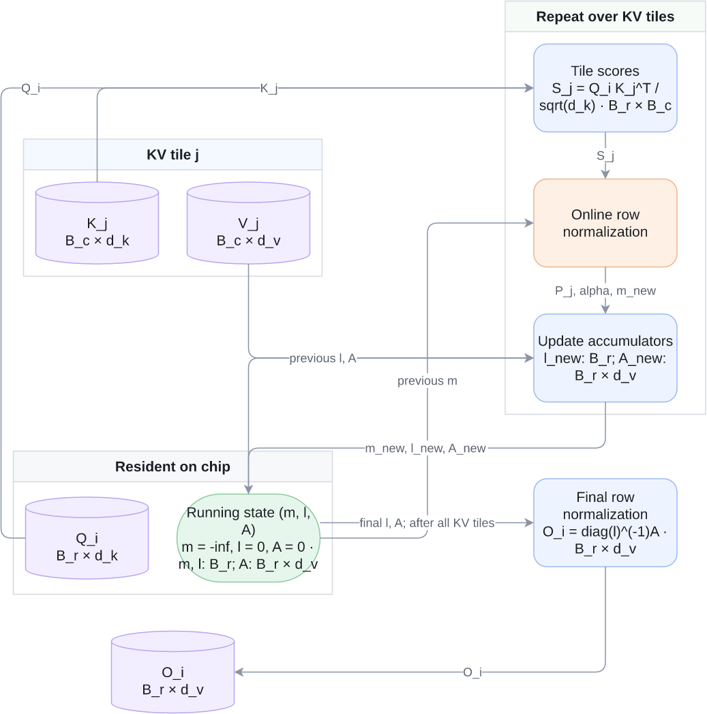
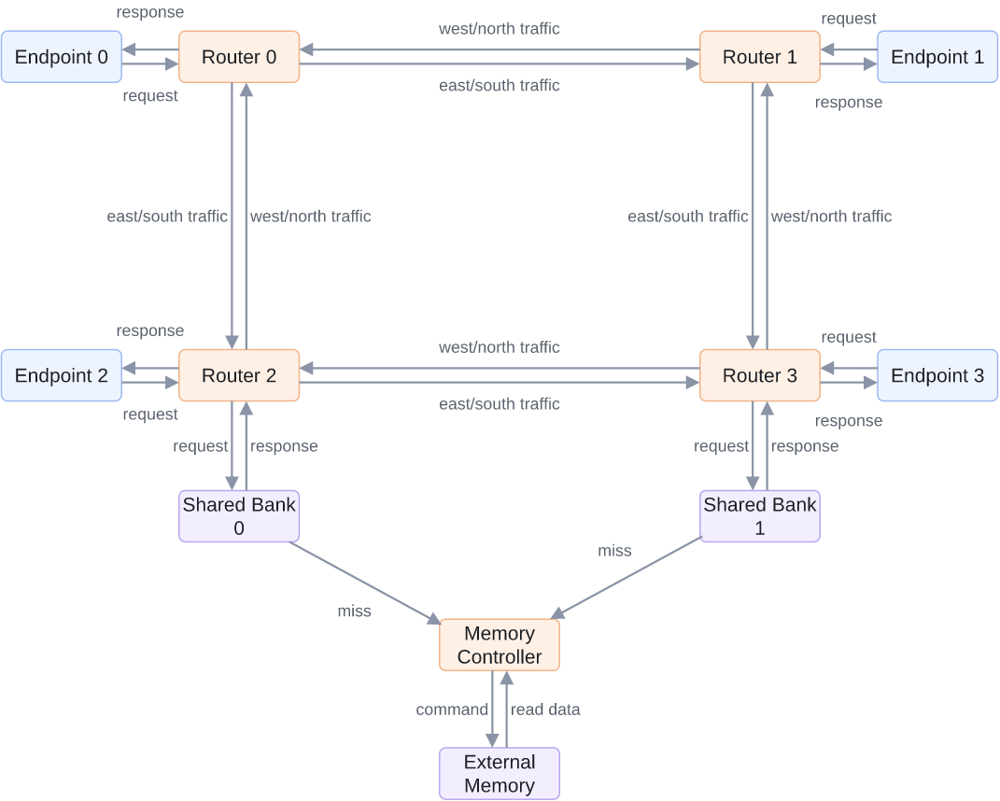
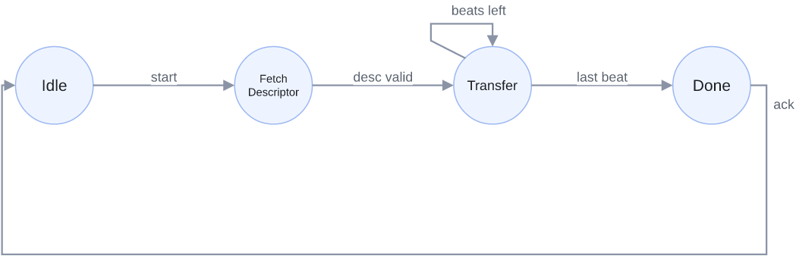
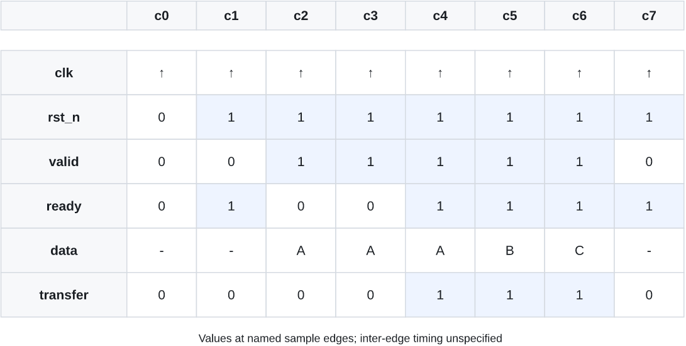
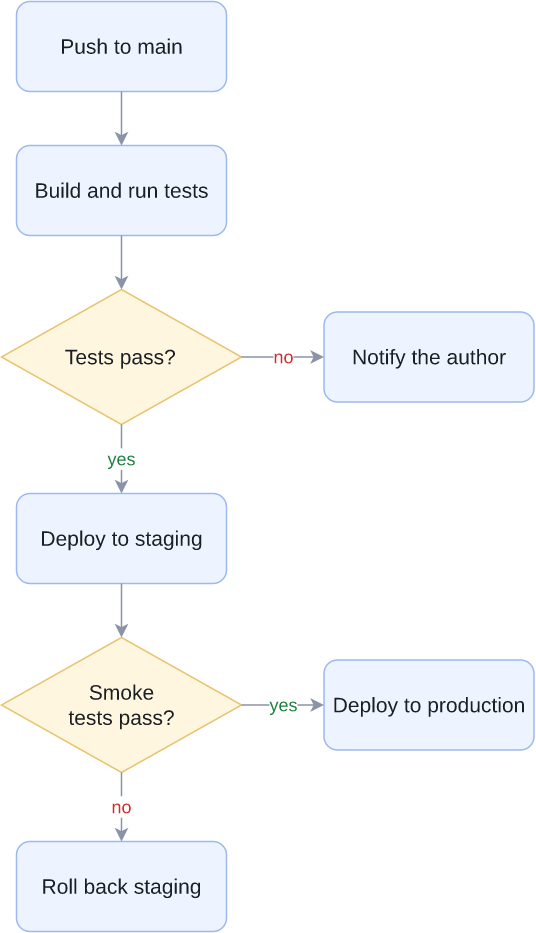
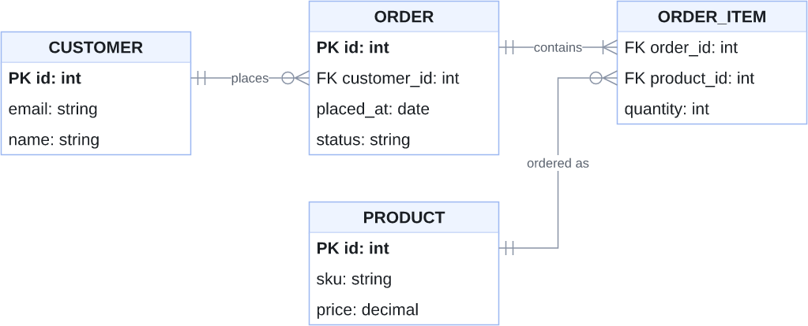

# draw-diagram

**An offline agent skill that turns a description of a chip, system, algorithm or process into an editable, layout-checked draw.io diagram.**

draw-diagram works in Claude Code, Codex and any agent that loads [Agent Skills](https://agentskills.io). It writes a native `.drawio` file, checks it for overlapping boxes, overflowing text and dangling connections, and renders it to PNG or SVG so the agent can look at what it drew. Everything runs locally on Node.js 20+, with no network access, no Python and no draw.io Desktop.

## Examples

Every image below was made by the skill's own commands (`node tools/build_examples.mjs`); click one to open its `.drawio` source.

| | |
|:---:|:---:|
| [](docs/examples/gpu-architecture.drawio)<br>**GPU architecture** | [](docs/examples/soc.drawio)<br>**SoC block diagram** |
| [](docs/examples/online-attention-dataflow.drawio)<br>**Online-softmax attention dataflow** | [](docs/examples/mesh-memory-noc.drawio)<br>**2×2 mesh network-on-chip** |
| [](docs/examples/dma-state-machine.drawio)<br>**DMA engine state machine** | [](docs/examples/ready-valid-timing.drawio)<br>**Ready/valid handshake timing** |
| [](docs/examples/release-pipeline.drawio)<br>**Release pipeline** (from [Mermaid](docs/examples/src/release-pipeline.mmd)) | [](docs/examples/online-store-schema.drawio)<br>**Database schema** (from [Mermaid](docs/examples/src/online-store.mmd)) |

## How it works

The skill picks one of two paths for each request:

- **Planned path**, for chip and system architecture, microarchitecture, algorithm and tensor dataflow, state machines and timing traces. `prepare` turns the user's description into instructions for writing a structured spec; the agent writes the spec; `compile` validates it and lays it out with the planning and layout engine of [silicon-canvas](https://github.com/du-du-wang/silicon-canvas), then converts the layout to draw.io. The engine is a JavaScript port of the Python original, checked byte for byte against CPython (see [`tools/port`](tools/port/README.md)).
- **Direct path**, for flowcharts, sequence diagrams, ER diagrams, org charts and the like. The agent writes Mermaid, PlantUML, draw.io CSV or draw.io XML, and `convert` turns it into a `.drawio` file with the converters of [drawio-mcp](https://github.com/jgraph/drawio-mcp). `search` finds draw.io shapes and vendor icons in a local index.

Either way the agent then runs `check` (geometry, no image needed) and `render`, which draws the page with [diagram-render](https://github.com/nowmyagentcan/diagram-render) compiled to WebAssembly, so the agent can look at the result before handing it over. Labels follow the user's language. Requests for photorealistic product renders, cutaways or 3D views are declined with an offer to draw a block diagram instead, since draw.io can't draw those.

Limitations: the renderer can't draw UML sequence lifelines, so a sequence diagram's PNG preview is wrong even though its `.drawio` file is fine (`render` warns about this); vendor icons render as labelled placeholders in the preview.

## Install

Replace `<owner>` with the GitHub user or organisation that hosts this repository (and `draw-diagram` after the slash with the repository name, if it differs). `draw-diagram@draw-diagram` is `plugin@marketplace`; both names come from this repository's manifests, not from GitHub.

**Claude Code**

```sh
claude plugin marketplace add <owner>/draw-diagram
claude plugin install draw-diagram@draw-diagram
```

Inside a session, `/plugin marketplace add <owner>/draw-diagram` and `/plugin install draw-diagram@draw-diagram` do the same; Claude Code 2.1.275 and later also take `/plugin install draw-diagram --marketplace <owner>/draw-diagram`. The skill loads by itself when you ask for a diagram, or explicitly as `/draw-diagram:draw-diagram`.

**Codex**

```sh
codex plugin marketplace add <owner>/draw-diagram
codex plugin add draw-diagram@draw-diagram
```

**Other agents, with [`npx skills`](https://skills.sh)**

```sh
npx skills add <owner>/draw-diagram
```

It asks which agents to install for; `-a claude-code`, `-a codex` and so on choose directly.

**By hand**: copy `plugins/draw-diagram/skills/draw-diagram` into your agent's skills folder (for Claude Code, `~/.claude/skills/`). Claude Code sessions inside this repository load it without installing, through `.claude/skills/draw-diagram`.

## Using it

Ask for a diagram in plain words, for example:

- "Draw the architecture of a GPU with four compute clusters, a shared L2 and HBM."
- "Show the dataflow of FlashAttention's online softmax for one query tile."
- "Make a state machine for a DMA engine: idle, fetch descriptor, transfer, done."
- "Turn this Mermaid flowchart into a draw.io file and render a PNG."

The answer is a `.drawio` file that opens in [draw.io](https://app.diagrams.net), draw.io Desktop or the draw.io editor extensions. The commands the agent uses are documented in [`SKILL.md`](plugins/draw-diagram/skills/draw-diagram/SKILL.md); they also work from a terminal:

```sh
node plugins/draw-diagram/skills/draw-diagram/scripts/draw-diagram.js --help
```

## Repository layout

| Path | Contents |
| --- | --- |
| `plugins/draw-diagram/` | The plugin: Claude Code and Codex manifests (`.claude-plugin/`, `.codex-plugin/`) and `skills/draw-diagram/`, the skill itself (SKILL.md, CLI, engine, converters, renderer, NOTICE) |
| `.claude-plugin/`, `.agents/plugins/`, `skills.sh.json` | Marketplace manifests for Claude Code and Codex; where `npx skills` finds the skill |
| `docs/examples/` | The example diagrams above and their Mermaid sources |
| `tests/draw-diagram/` | Tests of the skill, including golden layouts and drawings of 27 specs; need only Node |
| `tests/port/` | Comparison of the JavaScript engine with the CPython original; need the reference Python, see `tools/port/README.md` |
| `tests/upstream/silicon-canvas/` | Upstream spec files the tests compile (copied verbatim, MIT) |
| `tools/port/` | silicon-canvas's Python source, the Python-to-JavaScript translator and the reference bridge |
| `tools/diagram-render-wasm/` | Patch and script that build diagram-render as WebAssembly |
| `tools/widths/` | Script that measures the text width table `data/widths.json` |
| `tools/build_examples.mjs` | Regenerates `docs/examples` |

## Development

```sh
npm test                       # the skill's tests (Node only)
npm run test:port              # JavaScript engine vs CPython (needs Python 3.14 with Pillow)
npm run build:engine           # re-translate the engine after changing tools/port
node tools/build_examples.mjs  # regenerate docs/examples
```

When releasing, bump `version` in both `plugins/draw-diagram/.claude-plugin/plugin.json` and `.codex-plugin/plugin.json`; a test checks that they agree, and Claude Code uses the version to decide when to update.

## License

Each part keeps its upstream licence: drawio-mcp and diagram-render are Apache-2.0, silicon-canvas is MIT, and the Liberation fonts are OFL-1.1. See [`NOTICE`](plugins/draw-diagram/skills/draw-diagram/NOTICE) for what comes from where and what was changed.
